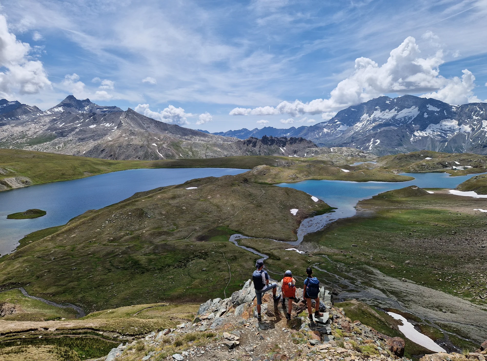
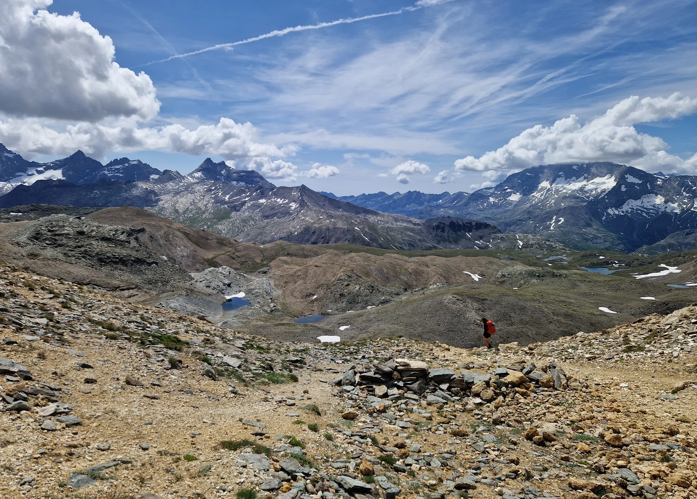
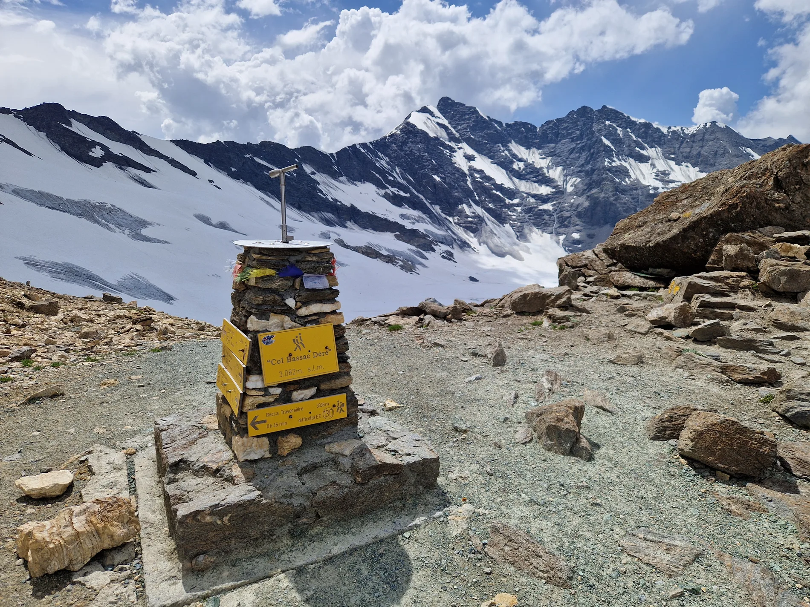
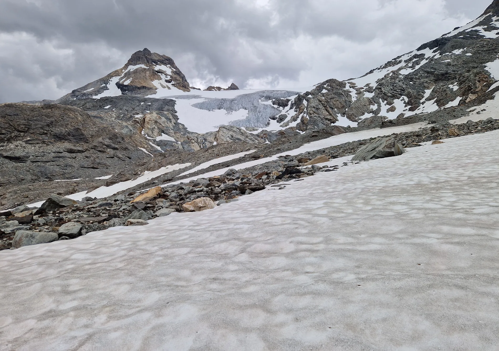
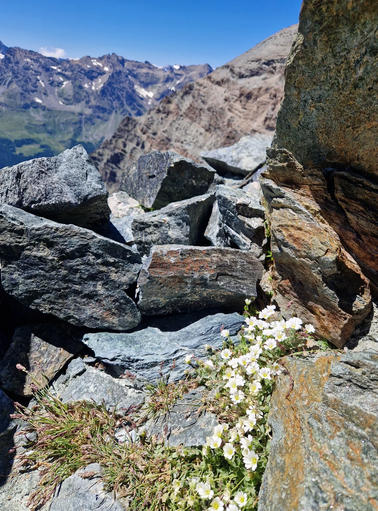
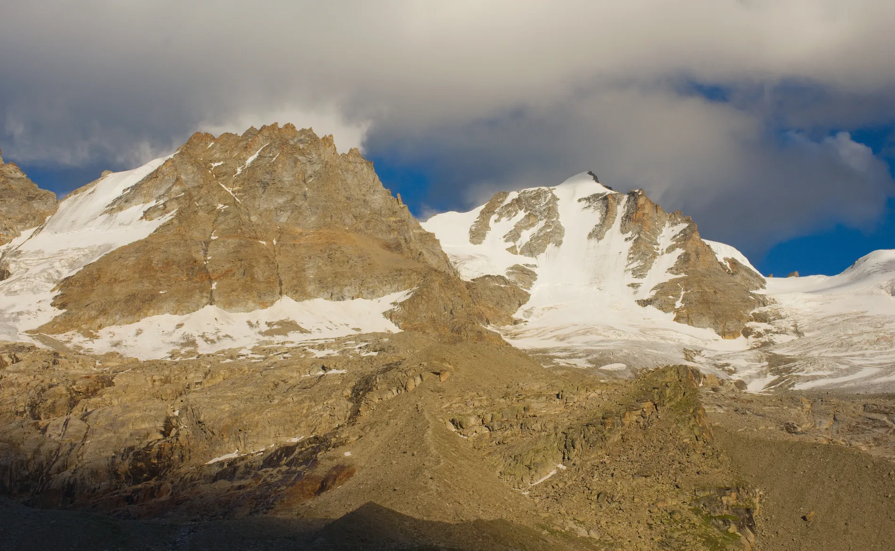
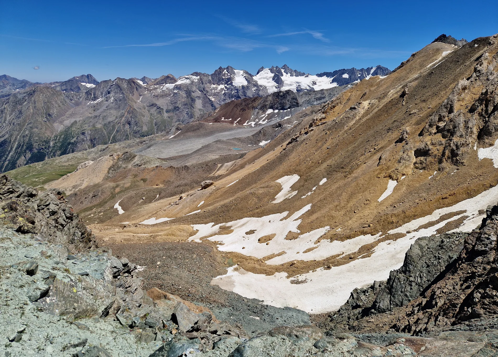
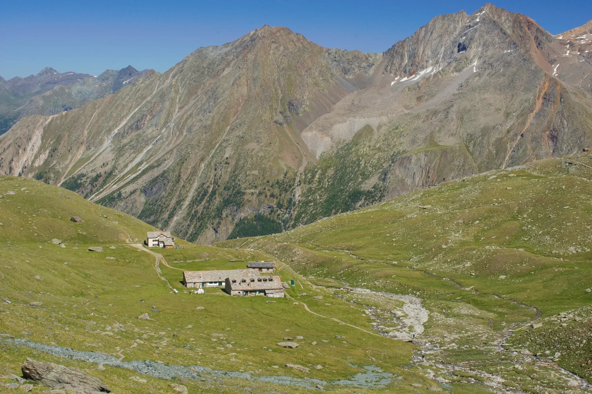
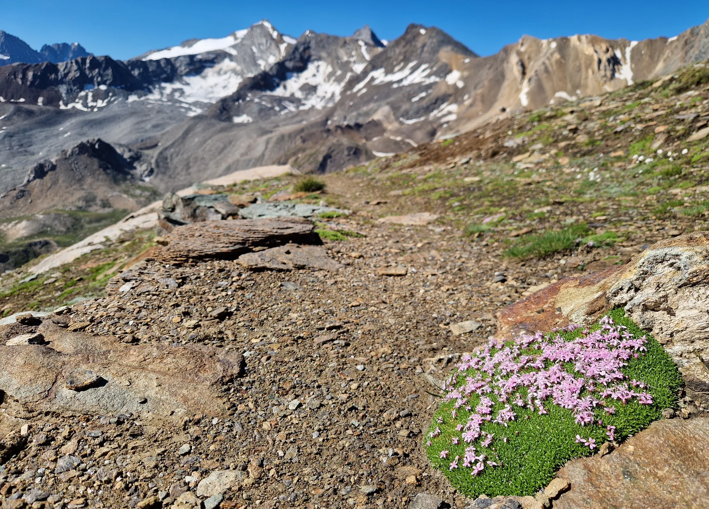
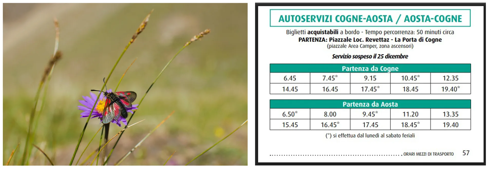

Už dlouho jsem žádný trek nesepsala. No, to proto, že už dlouho mě žádný trek tak hluboce nezasáhl krajinou, výhledy i neporušeností přírody. Žádné lanovky, sjezdovky, vleky – ani cestou, ale ani v krajině. Jen stříbrné ledovce, bílá sněhová pole, zelené koberce trav, kvetoucí louky a kamenitá sedla, přičemž jedno hraje všemi odstíny hnědé a další je jak z cesty do Mordoru, ocelově šedé. Mezi kameny a sněhem vykukují barevné a neskutečně odolné kytky, a jak jich je tady nahoře málo, tak o to víc vyniknou. Protože jak už to bývá, jen toho, čeho je nedostatek, toho si lidé váží…

Ale zpátky k treku samotnému. Jako každý rok posledních pár let, i letos jsme chtěli s dětmi vyrazit na přechod nějaké hezké části Alp. Já mám slabost pro údolí Aosty, která se zrodila z mnoha předchozích výprav, jenž mně sem zavedly, a tak jsem se rozhodla, že i když je to z Čech celkem daleko, vyrazíme sem. Národní park Gran Paradiso je, jak říká teta Wiki: „italský národní park založený v roce 1922. Jedná se o historicky první národní park v Itálii. Leží na severozápadě země, v regionech Údolí Aosty a Piemont a sousedí s francouzským národním parkem Vanoise.“ Teta Wiki ještě nebásní o jeho kráse, jelikož tam asi nebyla. Teď si říkám, jestli to vůbec mám psát já – ještě se to proflákne a budou sem jezdit lidi! Těch je tu totiž zatím poskrovnu. Víc lidí jsme potkali jen přímo pod Gran Paradiso, ale mimo hlavní tah nahoru na horu, je všude klid a liduprázdno. Možná, že v době francouzských letních prázdnin to ale bude jinak.

My jsme vyrazili brzy ráno s konce údolí Valgrisenche, z vesničky Les Usellières. Tady jsme na týden nechali auto a už už jsme si to štrádovali do kopce, když tu k nám zavoněl teplý, čerstvě upečený croissant. A kafe. Hm, tak to náš přece zas tak moc nezdrží, že jo. Na konci téhle vesnice je bývalá salaš, kterou místní aktivní babka přetavila na bar a dokonce tu peče vlastní croissanty. Pecka.

První etapa má za cíl Rifugio Benevolo, které je malé, ale obrovsky pohostinné. Viva Italia. Cesta z Les Usellières stoupá přes louky a kolem Rifugio Mario Bezzi do našeho prvního sedla Col Bassac Deré, vysokého 3083 m. Jelikož na jaře spadlo v téhle oblasti dost sněhu, trochu jsme se obávali o průchodnost sedel, protože všech pět, které potkáme, má nad tři tisíce. Právě tady, v Bassac Deré, bylo sněhu nejvíc, ale ani tady, ani nikde jinde, ho nebylo tolik, že by se nedalo bezpečně a bez problémů projít. Míjíme třpytící se ledovce Gliairetta a Golettaz a modré Lago di Golettaz, azurový oblázek zasazený v krajině kamenných obrů. Dnes nastoupáme 1291m, dolů sejdeme 810 m a celá etapa zabere 7 až 8 hodin. My tedy jdeme trek po chatách, užíváme si italskou pohostinnost i kuchyni. Oficiálně je v národním parku stanování zakázáno, takže aspoň máme výmluvu a můžeme si na chatách povídat nejen s Italy, ale také třeba s Nizozemci, kteří jsou, skoro až vtipně, vyplesklí z kopců, na které doma opravdu nemají jak natrénovat. Také jsme díky večernímu klábosení obohatili život dvou starších Britů o hru Prší. A naše holky o patřičnou slovní zásobu potřebnou k vysvětlení pravidel.

Druhý den pokračujeme směrem k Rifugio Tètras Lyre, kde překročíme údolí Valsavarenche. Pro zajímavost, tady by se dalo něco málo dokoupit, cesta vede kolem kempu a tudíž i malého krámku. Rifugio Tètras Lyre není klasická horská chata, asi bych si ho primárně nevybrala, leží dole v údolí, jen ve výšce 1960m n. m. a je na můj vkus až příliš snadno dostupné. Nám ale vychází nejlépe do itineráře, tak to zkusíme – a italská povaha nezklame, i tady jsou moc fajn lidi. Etapa tentokrát vede přes Col Rosset (3023m), stoupáme sutí, nahoře čekají parádní výhledy a za sedlem se cesta pomalu překlopí do mechově jemné zeleně. Ta pokrývá svahy, po nichž klesáme do údolí Valsavarenche a k Lago Rosset, v jehož trochu chladnějších vodách se dá vykoupat. Dnešní úsek je stejně časově náročný jako ten včerejší, také 7 až 8 hodin, ale je to jen 883 m nahoru a 1197 m dolů.

Další etapu jsem úmyslně zvolila jako odpočinkovou. Je to zároveň také právě tento úsek, kdy během prvních dvou hodin potkáme stejné množství lidí, jako za celý zbytek treku. Všichni míří do populární Rifugio Vittorio Emanuele II. Upřímně, není o co stát, já tuhle chatu raději obešla kolem, nemám v lásce frekventovaná místa v horách. Právě z tohoto rifugia se nejčastěji vyráží na vrchol Gran Paradisa. Někdo jde s horským vůdcem, někdo sám, ale pokud se obě chaty, ze kterých vyrazit lze, naplní, míří ráno k vrcholu až 200 lidí. Hm, dobře, tak my raději jdeme dál. Útočiště nacházíme v menším a méně profláknutém Rifugio Chabod. I odsud se dá startovat na vrchol, ale asi díky trochu delší nástupové trase od parkoviště, je tu méně plno. Zato se z vyfoukané terasy otevírá nádherný výhled na ledovec i vrchol Gran Paradiso, který zlátne v zapadajícím slunci. Plánování nezklamalo, dnešní etapa je krátká a tak odpoledne přišla bouřka. Jen tak na chvíli se stavila a jen o chvíli dřív než měla, jen tak, aby nám promočila bundy a pak zase šla. Naštěstí předpověď na další den je dobrá a to potřebujeme. Na Rifugio Chabod jsme šli 4 a půl hodiny, nastoupali jsme 942m a seběhli jsme 231m.

Čtvrtá etapa vede přes dvě sedla, nejprve stoupáme do Passage du Grand Neyron, vysokého 3252 m, posléze do nejvyššího sedla treku, měsíčního Col du Lausson, 3299 m. Míříme do útulného Rifugio Vittorio Sella, čeká nás 8 až 9 hodin chůze, přičemž to bude 1272m stoupání a 1391m klesání. Mezi oběma sedly se rozprostírá malebné údolíčko, do kterého je nutno sestoupit s jistou dávkou opatrnosti. Cesta ze sedla Grand Neyron je exponovaná, ale také velmi dobře zajištěná celkem dlouhou řadou řetězů, lan a žebříků. Je dobré tady počítat víc času na sestup. Zároveň, díky strmosti, kterou svah padá dolů, tady nebyl skoro žádný sníh. Col du Lausson jsme shodou náhod potkali už o den dříve – vyfocené v magazínu národního parku. Je to representativní, fotogenické místo, šedá břidlice se leskne na sluníčku a dává mu přiléhavou přezdívku „měsíční sedlo“. A i když výstup ani sestup není nijak náročný, je to určitě jedno z nejimpozantnějších sedel treku. Šedou doplňuje hnědá, kopce kolem jsou pruhované všemi možnými odstíny rezavé a hnědé, které si jen dovedete představit. Scenérii doplňuje masiv Monte Rosa s Dufourspitze, ledový Grand Combin a v jistou chvíli i Mount Blanc. Jak malý je takhle z dálky. Charakteristickou špičku Matterhornu, tu jsme poznali hned. Ale ten se na obzoru vyloupl až o den později.

Z Col du Lausson jsme seběhli do malebného Rifugio Vittorio Sella. Nízké bílé stavení, kolem kterého zurčí potok mezi zelenými bochánky trávy (koupačka!), pro samého sviště není kam šlápnout a večer se na louky k potoku stahují kozorožci. Jestli Col du Lausson vyhrává jako sedlo, pak Vittoria Sella vyhrává jako nejlepší rifugio treku. Včetně kuchařky i chataře. Sella je bývalá lovecká chata, achitekturou připomínající spíš salaš. Chatu přebudovali na rifugio krátce po založení národního parku a v sezóně francouzských prázdnin je zřejmě celkem oblíbeným výletním cílem. Dá se z ní spadnout do údolí Cogne, do Valnontey, odkud pendluje autobus do Cogne. Až do Cogne ale cesta trvá jen 3 hodiny (přes les a kopeček Baben) a byla by škoda zkracovat si jí autobusem.

Nechce se nám dolů. Nikdy se nám nechce dolů, ale tentokrát prostě dolů nejdeme, alespoň ne dnes. Jelikož jsme ale narychlo nevymysleli smysluplné prodloužení treku, zůstáváme na Vittorio Sella a další den vyrážíme na okruh přes Colle della Rossa (3193 m) a Col Ouille. Je tu prostě hezky, člověk se musí občas až zastavit, aby si to pořádně vychutnal.

PS. Praktické informace závěrem. Z Cogne jezdí autobus do Aosty, z Aosty se musí dalším autobusem do Villeneuve a teprve odtud pak jezdí autobus do Les Usellières. Nejsme v Indii, takže to jezdí celkem podle jízdního řádu. Ale jsme v Itálii, takže jízdní řád nikoho nezajímá, zato vás řidič hodí, kam že to vlastně chcete?

